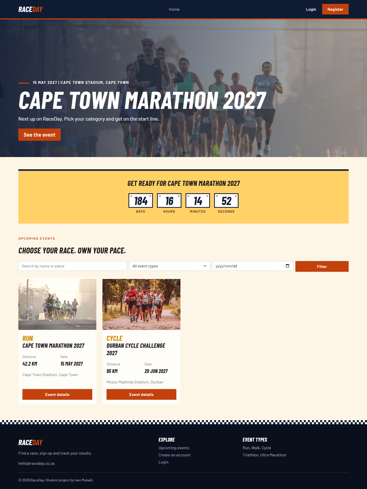

RaceDay Event Management System

Name: Ives Mukadi
Student Number: st10365478
Module: Programming 2B

Project Overview
RaceDay is a platform for managing running, walking and cycling events. Organisers create events and record results, and participants browse events, enrol in a category and look at their own results. I built it in three parts, and all three are in this repository:
Part 1 is the planning (ERD, endpoint plan and SQL script), Part 2 is the Web API with its unit tests, and Part 3 is the MVC web app that uses the API, plus image uploads to Azure Blob Storage and a Docker container.

Roles
Organiser: creates, edits and deletes their own events, manages the categories of an event, sees who enrolled and changes their status, and captures results.
Participant: registers, browses events, enrols in an event by choosing a category, and sees their own enrolments and results.

Part 1: Planning
The files are in Part1/docs: ERD.png (8 entities), API_Endpoint_Plan.pdf (the 21 planned endpoints) and raceday_setup.sql (creates the RaceDay database, tables and sample data).

To run the script, open it in SQL Server Management Studio, click Execute (F5) and check that RaceDay has 8 tables. It creates the database itself, so drop RaceDay first if it already exists.

I improved the SQL script after drawing the ERD, so they differ in a few places:
1. Some foreign keys use ON DELETE CASCADE (Categories to Events, Enrolments to Events, Results to Enrolments), so deleting an event also deletes everything under it. The other keys do not cascade because SQL Server does not allow multiple cascade paths.
2. Categories has a UNIQUE constraint on (EVENT_ID, CATEGORY_NAME), so an event cannot have two categories with the same name.
3. Events.EVENT_STATUS_ID and Enrolments.STATUS_ID are NOT NULL with defaults (2 and 1).
4. The Event_Status primary key is called EVENT_STATUS_ID in the script and STATUS_ID in the ERD.
5. Users has a PROFILE_PICTURE_URL column and Events has a BANNER_URL column for the Azure image links (needed in Part 3).
6. The seed passwords in the script are placeholders. The API does the real hashing.

Part 2: The API
The API is ASP.NET Core Web API on .NET 8 with Entity Framework Core (Code-First) and SQL Server. The code is in Part2/RaceDay.Api and the 104 unit tests are in Part2/RaceDay.Api.Tests. Each controller covers one area (Auth, Users, Events, Categories, Enrolments, Results). The Dtos folder holds the request and response shapes, so password hashes never leave the API.

Endpoints
Auth: POST /api/auth/register, POST /api/auth/login, POST /api/auth/logout
Users: GET and PUT /api/users/me, POST /api/users/me/picture, GET /api/users/me/enrolments and /api/users/me/results
Events: GET /api/events (filters: type, status, date), GET /api/events/{id}, GET /api/events/mine, POST /api/events, PUT and DELETE /api/events/{id}, POST /api/events/{id}/banner
Categories: GET and POST /api/events/{eventId}/categories, PUT and DELETE /api/categories/{id}
Enrolments: POST /api/events/{eventId}/enrol, GET /api/events/{eventId}/enrolments, PUT /api/enrolments/{id}/status
Results: POST and GET /api/events/{eventId}/results

Browsing events and categories is open to everyone. Creating, changing and deleting events, categories and results is for Organisers, and only for their own events. Enrolling and viewing your own enrolments and results is for Participants. A logged out user gets 401 on protected endpoints and the wrong role gets 403.

Login uses ASP.NET Core cookie authentication. The RaceDay.Session cookie holds the user id and role, and passwords are hashed with BCrypt.

Differences from the Part 1 endpoint plan
1. I added GET /api/events/mine so an Organiser can list their own events.
2. The results responses include TotalFinishers, so Part 3 can show "34th out of 3 finishers".
3. The Part 1 plan said there were 3 public endpoints, but its table shows 5 (register, login, list events, event details and event categories). The table is right.
4. In Part 3 I added two upload endpoints for Azure Blob Storage, POST /api/events/{id}/banner and POST /api/users/me/picture. They accept a jpg or png up to 2 MB.

Part 3: The MVC app
The MVC app is in Part3/RaceDay.Web (ASP.NET Core MVC on .NET 8 with Bootstrap). It never touches the database or Azure itself, every page gets its data from the API. The main parts are:
Controllers: Home (events), Account (login, register, profile), Participant and Organiser
Services: ApiClient (every call to the API) and ApiCookieHandler (adds the login cookie to each call)
Filters: RoleRequired, which limits a page to one role
Models, Views and wwwroot: the forms and API classes, the pages, and the CSS, script and images

This is the home page running locally:

What each role can do
Everyone can see upcoming events, search by name or place, filter by type or start date, see a countdown to the next event and open an event's details.
A Participant can enrol in an open event, see their enrolments (My Events) and results (My Results), and edit their profile and picture.
An Organiser gets a dashboard, can create, edit and delete events with a banner image, manage categories, see enrolments and change their status, enter results for completed events, and edit their profile and picture.

How login works in the MVC app
The MVC app logs in through the API and keeps the API's cookie in its own session, together with the user's name, role and picture. It sends that cookie on every API call, so the API still decides who the user is. Each Organiser and Participant page also checks the role first. A logged out user goes to the login page and the wrong role gets an Access denied page. If the cookie expires the user is sent back to log in, and if the API is down the pages show a "can't reach the server" message.

Things I did differently
1. The API has no endpoint for event types or statuses, so I wrote those lists into Models/Lookups.cs with the same ids as the database.
2. The API cannot search by name, so the home page filters the name and the start date in the MVC app.
3. Numbers use a dot (42.2 km) so the browser form and the server agree.

How to run everything
1. Start SQL Server: docker run -e ACCEPT_EULA=Y -e MSSQL_SA_PASSWORD=YourPassword -p 1433:1433 -d mcr.microsoft.com/mssql/server:2022-latest
2. Save the connection string as a user secret (it is not in the repo): dotnet user-secrets set "ConnectionStrings:RaceDay" "Server=localhost,1433;Database=RaceDayApi;User Id=sa;Password=YourPassword;TrustServerCertificate=True" --project Part2/RaceDay.Api
3. Create the database: cd Part2, then dotnet tool restore, then dotnet tool run dotnet-ef database update --project RaceDay.Api
4. Start Azurite, the local stand-in for Azure Blob Storage: docker run -d --name raceday-azurite -p 10000:10000 -p 10001:10001 -p 10002:10002 mcr.microsoft.com/azure-storage/azurite azurite --blobHost 0.0.0.0 --queueHost 0.0.0.0 --tableHost 0.0.0.0 --skipApiVersionCheck
5. Save the blob connection string as a secret: dotnet user-secrets set "Blob:ConnectionString" "UseDevelopmentStorage=true" --project Part2/RaceDay.Api
6. Run the API: dotnet run --project Part2/RaceDay.Api --launch-profile http (Swagger is at http://localhost:5100/swagger)
7. In a second terminal run the MVC app: dotnet run --project Part3/RaceDay.Web --launch-profile http
8. Open http://localhost:5200 and log in.

The sample data is added the first time the API starts. The password for every sample login is Password123!
thabo@raceday.co.za and priya@raceday.co.za are Organisers.
amara@raceday.co.za, david@raceday.co.za and lindiwe@raceday.co.za are Participants.

To try a protected endpoint in Swagger, run POST /api/auth/login first. The browser keeps the cookie.

Azure Blob Storage
The API saves banners and profile pictures in a blob container called raceday-images (folders banners and profiles). The container is created with public read access, so the browser can show the images straight from their links. For real Azure, create a storage account, allow public blob access on it, and save its connection string as the Blob:ConnectionString secret instead (or as the Blob__ConnectionString environment variable). It is a secret, so it never goes in the repo.

Docker
Build the image: docker build -t raceday-web Part3/RaceDay.Web
Run it: docker run --rm -p 5200:8080 raceday-web
The container only holds the MVC app, so SQL Server, Azurite and the API need to be running on my machine first. The container looks for the API at http://host.docker.internal:5100 and cannot reach an API that only listens on localhost, so I start the API for Docker like this: dotnet run --project Part2/RaceDay.Api --urls http://0.0.0.0:5100
To use a different API address, add -e Api__BaseUrl=http://your-api-address to the run command.

How to run the unit tests
dotnet test Part2/RaceDay.sln
The tests use an in-memory database, so SQL Server is not needed. They cover registering, logging in, events, role checks (401 and 403), enrolments, categories, results and the image uploads (with a fake blob service), for both success and failure cases.

Image credits
The photos on the home page and the default event picture are free to use under the Pexels licence. The photographers and links are in Part3/RaceDay.Web/wwwroot/images/CREDITS.txt.

CI/CD
Two GitHub Actions workflows run on every push. Docs check makes sure the ERD, endpoint plan and SQL script are in Part1/docs. Build and test builds the API and the MVC app, runs all the unit tests and builds the Docker image.

Docs check (Part 1):

Build and test (Part 2):

