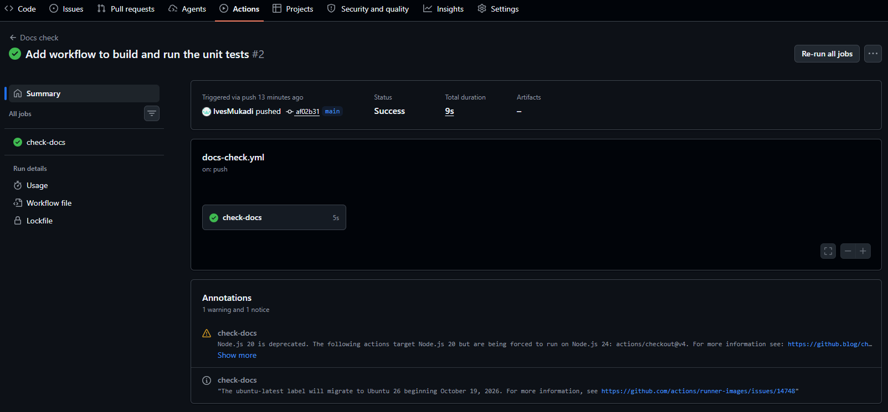
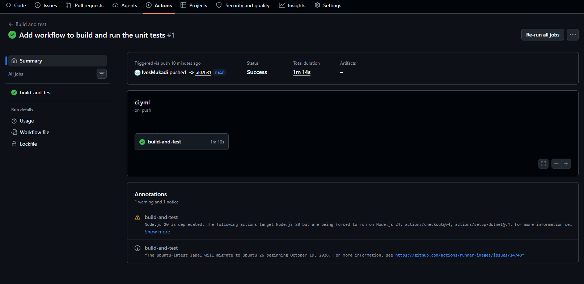

Project Title
RaceDay Event Management System

Student Information
Name: Ives Mukadi
Student Number: st10365478
Module: Programming 2B

Project Overview
RaceDay is a platform for managing running, walking and cycling events. Organisers create events and record results, and participants browse events, enrol in a category and view their own results. The project is built in three parts. This repository currently contains Part 1 (the planning documents and the SQL database script) and Part 2 (the Web API and its unit tests).

Roles
Organiser: can create, edit and delete events, manage event categories, view all enrolments for their events and capture participant results.
Participant: can create an account, browse events, enrol in an event by choosing a category, view their own enrolments and track their personal results.

Part 1 Details
Part 1 covers planning only. No API code has been written yet.

Files in Part1/docs:

ERD.png - entity relationship diagram (8 entities)
API_Endpoint_Plan.pdf - table of all 21 API endpoints
raceday_setup.sql - creates the RaceDay database, tables and sample data

How to run the SQL script
1. Open SQL Server Management Studio and connect to your server.
2. Open Part1/docs/raceday_setup.sql.
3. Click Execute (F5).
4. Refresh Databases and check that RaceDay has 8 tables.

The script creates the database itself, so run it on a clean server. If RaceDay already exists, drop it first.

Differences between the ERD and the SQL script
The SQL script was improved after the ERD was drawn. These are the deliberate differences:

Some foreign keys use ON DELETE CASCADE (Categories to Events, Enrolments to Events and Results to Enrolments), so deleting an event also deletes its categories, enrolments and results. The other foreign keys do not cascade because SQL Server does not allow multiple cascade paths. The ERD does not show this.
Categories has a UNIQUE constraint on (EVENT_ID, CATEGORY_NAME) so an event cannot have two categories with the same name.
Events.EVENT_STATUS_ID and Enrolments.STATUS_ID are NOT NULL with defaults (2 and 1). The ERD does not show this.
The primary key of Event_Status is named EVENT_STATUS_ID in the SQL script. The ERD calls it STATUS_ID.
Users has an extra nullable PROFILE_PICTURE_URL column and Events has an extra nullable BANNER_URL column. They hold the Azure Blob Storage links for profile pictures and event banners (needed in Part 3). The ERD does not show them.
Seed passwords are placeholders (hashed_pass_1 and so on). Real hashing is done in the API in Part 2.

Part 2 Details
Part 2 is a RESTful API built with ASP.NET Core Web API on .NET 8, Entity Framework Core (Code-First) and SQL Server. The code is in Part2/RaceDay.Api and the unit tests are in Part2/RaceDay.Api.Tests.

How the roles work in the API
The API checks the role on every endpoint. A logged out user gets 401 on protected endpoints. A Participant gets 403 on Organiser endpoints, and an Organiser gets 403 on Participant endpoints. An Organiser can only change events, categories, enrolments and results that belong to their own events.

How login works
Logging in sets a cookie called RaceDay.Session (ASP.NET Core cookie authentication). The cookie keeps the user id and role, so every later request knows who the user is. Logging out removes it. Passwords are hashed with BCrypt before they are saved.

How to run the API
1. Start SQL Server. For example with Docker: docker run -e ACCEPT_EULA=Y -e MSSQL_SA_PASSWORD=YourPassword -p 1433:1433 -d mcr.microsoft.com/mssql/server:2022-latest
2. Save the connection string as a user secret (it is not stored in the repo): dotnet user-secrets set "ConnectionStrings:RaceDay" "Server=localhost,1433;Database=RaceDayApi;User Id=sa;Password=YourPassword;TrustServerCertificate=True" --project Part2/RaceDay.Api
3. Create the database: cd Part2, then dotnet tool restore, then dotnet tool run dotnet-ef database update --project RaceDay.Api
4. Run the API: dotnet run --project Part2/RaceDay.Api --launch-profile http
5. Open http://localhost:5100/swagger to see and try every endpoint.

The sample data is added automatically the first time the API starts.

Sample logins (the password for all of them is Password123!)
thabo@raceday.co.za - Organiser
priya@raceday.co.za - Organiser
amara@raceday.co.za - Participant
david@raceday.co.za - Participant
lindiwe@raceday.co.za - Participant

To try a protected endpoint in Swagger, run POST /api/auth/login first. The browser keeps the cookie, so the next requests are logged in.

How to run the unit tests
dotnet test Part2/RaceDay.sln
The tests use an in-memory database, so SQL Server is not needed. They cover registering, logging in, event management, role checks (401 and 403), enrolments, categories and results, for both success and failure cases.

Differences between the Part 1 endpoint plan and the API
1. One extra endpoint was added: GET /api/events/mine. It lets an Organiser list the events they created.
2. The results responses include TotalFinishers, so the web app in Part 3 can show a position like 34th out of 2.
3. The Part 1 plan listed 3 public endpoints in its summary, but the table has 5 (register, login, list events, event details and event categories). The table is correct.

CI/CD
Two GitHub Actions workflows run on every push. Docs check makes sure the ERD, endpoint plan and SQL script are in Part1/docs. Build and test builds the API and runs all the unit tests.

Docs check (Part 1):

Build and test (Part 2):

